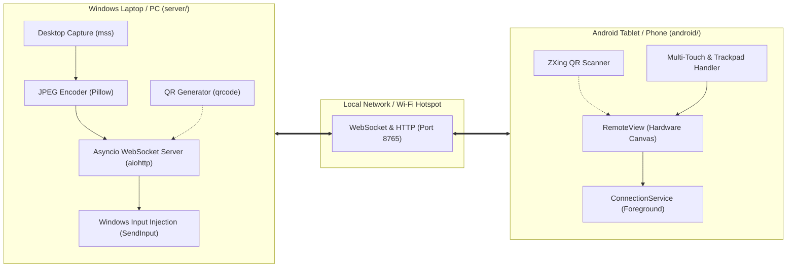

# LapCast 🚀

[](LICENSE)
[](https://microsoft.com/windows)
[-3DDC84.svg?logo=android)](https://android.com)
[](https://python.org)
[](https://gradle.org)

> **Turn your Android tablet or phone into a high-performance, low-latency, touch-enabled wireless secondary display for Windows.**

LapCast connects your Windows PC to an Android device over your local Wi-Fi or Windows Mobile Hotspot. It streams your desktop with high visual fidelity and feeds touch, mouse, and keyboard inputs straight back into Windows using native `SendInput` APIs.

---

## ✨ Features

- ⚡ **Ultra-Low Latency Streaming**: Native Windows desktop capture using [`mss`](https://github.com/BoboTiG/python-mss) and optimized JPEG streaming over WebSockets via [`aiohttp`](https://github.com/aio-libs/aiohttp).
- 📷 **Zero-Config QR Code Pairing**: Scan the QR code displayed in the Windows terminal or browser with your tablet camera for instant connection—no manual IP or PIN typing required.
- 👆 **Dual Interaction Modes**:
  - **Direct Touch Mode**: Absolute coordinate mapping translates tablet touches directly into Windows cursor clicks and drags.
  - **Trackpad Mode**: Acts like a precision laptop touchpad with relative cursor acceleration and gestures.
- ⌨️ **Full Keyboard & Shortcut Support**:
  - Floating sticky modifier toolbar (**Ctrl**, **Alt**, **Shift**, **Win**, **Esc**, **Tab**) with auto-release after non-modifier keystrokes.
  - Native hardware keyboard event forwarding with Windows hotkey handling (e.g., `Win + R`, `Alt + Tab` are passed to Windows rather than intercepted by Android).
  - On-screen soft keyboard toggle.
- 🔍 **Zoom & Pan Navigation**:
  - Dynamic zoom in/out with 100% 1-tap reset.
  - 4-way directional pad to navigate across large desktop viewports on compact tablet screens.
- 🛡️ **Background Connection Persistence**: An Android Foreground Service keeps the WebSocket connection alive even when switching apps or locking the screen.
- 🖥️ **Multi-Monitor Selection**: Easily cast primary or secondary displays with the `--monitor` argument.
- 🔐 **PIN Authentication**: Secure handshake with brute-force delay protection.

---

## 🏗️ Architecture



---

## 📁 Repository Structure

The project is cleanly split into two independent modules:

```
LapCast/
├── README.md                  # Project documentation
├── LICENSE                    # MIT License
├── .gitignore                 # Root repository ignore rules
│
├── server/                    # 🐍 Python Windows Host Server
│   ├── lapcast_server.py      # Core screen streamer & input injection engine
│   ├── requirements.txt       # Host server dependencies
│   └── start_server.bat       # 1-click Windows server launcher
│
└── android/                   # 🤖 Native Android Client Application
    ├── build.gradle           # Root Gradle configuration
    ├── settings.gradle        # Project module definitions
    ├── gradle.properties      # JVM memory and build configuration
    ├── gradlew & gradlew.bat  # Gradle wrapper executables
    ├── gradle/                # Gradle wrapper jar and version catalogs
    └── app/                   # Android Application module
        ├── build.gradle       # App module configuration (SDK 34, Java 17)
        └── src/main/
            ├── AndroidManifest.xml
            ├── java/com/lapcast/
            │   ├── MainActivity.java      # UI, QR scanner, toolbar & key dispatch
            │   ├── RemoteView.java        # Canvas rendering & touch/mouse input
            │   └── ConnectionService.java # Background persistence service
            └── res/                       # Icons, themes, colors, and layout strings
```

---

## 🚀 Quick Start

### 1. Windows Host Setup (`server/`)

#### Requirements
- Windows 10 or 11
- Python 3.8 or higher installed and added to `PATH`

#### 1-Click Launch (Recommended)
Navigate into `server/` and double-click:
```bat
start_server.bat
```
*(Run as **Administrator** if you need to control elevated applications or Windows UAC prompts).*

#### Or Run via Command Line
```powershell
cd server
pip install -r requirements.txt
python lapcast_server.py
```

Upon launching, the server will display:
- Available local network IP addresses
- A 6-digit random PIN
- An ASCII QR code right in your terminal
- A local URL (`http://<ip>:8765/qr`) to view the QR code in any browser

---

### 2. Android Client Setup (`android/`)

#### Download APK from Releases
Download the latest `lapcast.apk` from the GitHub **Releases** page of this repository, install it on your device, and grant camera permission when prompted for QR pairing.

#### Or Build from Source
To build the APK locally using the Gradle wrapper:

```bash
cd android
./gradlew assembleDebug
```
The compiled APK will be generated at:
```text
android/app/build/outputs/apk/debug/app-debug.apk
```

To install directly to a USB-connected device via ADB:
```bash
adb install -r android/app/build/outputs/apk/debug/app-debug.apk
```

#### Opening in Android Studio
1. Open Android Studio.
2. Select **File > Open...** and choose the `android/` directory.
3. Allow Gradle to sync dependencies and click **Run** (Shift+F10).

---

### 3. Pairing and Connecting

1. Launch **LapCast** on your Android device.
2. Tap **📷 Scan QR** and point your tablet camera at the QR code displayed in the Windows terminal or browser (`http://localhost:8765/qr`).
3. Connection establishes automatically in under a second!
4. *(Manual Alternative)* Enter your laptop's IP and port (e.g. `192.168.137.1:8765`) and PIN, then tap **Connect**.

> **💡 Best Performance Tip:** For minimum latency and stutter-free streaming, turn on **Mobile Hotspot** on Windows and connect your Android device directly to it. The host IP on Windows Hotspot is typically `192.168.137.1`.

---

## 🎮 Controls & Gestures

| Gesture / Action | Direct Touch Mode | Trackpad Mode |
|---|---|---|
| **Single Tap** | Left Click at touch point | Left Click at cursor position |
| **Touch & Drag** | Click and Drag (move windows, select text) | Move mouse cursor |
| **Long Press** | Right Click at point | Right Click at cursor position |
| **Two-Finger Scroll** | Vertical / Horizontal Wheel Scroll | Vertical / Horizontal Wheel Scroll |
| **Pinch / Zoom UI** | Bottom-right zoom buttons (`+`, `−`, `●`) | Bottom-right zoom buttons (`+`, `−`, `●`) |
| **Pan Navigation** | Bottom-right directional pad (`▲`, `▼`, `◀`, `▶`) | Bottom-right directional pad (`▲`, `▼`, `◀`, `▶`) |

### Top Toolbar (☰)
Tap the **☰** icon in the top right to access controls:
- **Touch / Pad**: Toggle between Direct Touch and Trackpad modes.
- **⌨ (Keyboard)**: Toggle soft keyboard.
- **Ctrl / Alt / Shift / Win**: Sticky modifier keys. Tap once to arm; automatically unlatches after your next keystroke/action. Multiple modifiers can be armed simultaneously (e.g. `Ctrl` + `Shift`).
- **Esc / Tab**: Quick access shortcut keys.
- **✕**: Disconnect and return to connection setup screen.

---

## ⚙️ Server Configuration Flags

Run `python lapcast_server.py --help` inside `server/` to view all available parameters:

| Flag | Default | Description |
|---|---|---|
| `--port <int>` | `8765` | WebSocket and HTTP listening port |
| `--fps <int>` | `30` | Target frame capture rate (e.g. `30` or `60`) |
| `--quality <int>` | `95` | JPEG quality from `1` to `100` (`95` is visually lossless) |
| `--monitor <int>` | `1` | Screen index to capture (`1` = primary display, `2` = secondary) |
| `--pin <string>` | *random 6-digit* | Custom authentication PIN (e.g. `--pin 123456`) |

#### Example: Stream 60 FPS on Secondary Display
```bash
python lapcast_server.py --fps 60 --quality 90 --monitor 2 --pin 999999
```

---

## 🔧 Troubleshooting

### 1. Connection Refused or Timeout
- Verify both your laptop and tablet are connected to the same Wi-Fi network or hotspot.
- Check Windows Firewall: allow incoming connections on port `8765` for Python.
- If using public Wi-Fi, router Client Isolation might prevent direct connections. Use a **Windows Mobile Hotspot** instead.

### 2. Cannot Click Elevated Windows (Task Manager, UAC)
- Windows UIPI (User Interface Privilege Isolation) restricts non-admin processes from injecting inputs into elevated windows.
- **Fix**: Right-click `start_server.bat` (or your command prompt) and choose **Run as Administrator**.

### 3. QR Code Not Appearing in Terminal
- Verify `qrcode` library is installed: `pip install qrcode[pil]`.
- Alternatively, view the QR code in any browser at `http://localhost:8765/qr`.

---

## 📄 License

This project is open-source and licensed under the [MIT License](LICENSE).
Feel free to use, modify, and distribute it!
